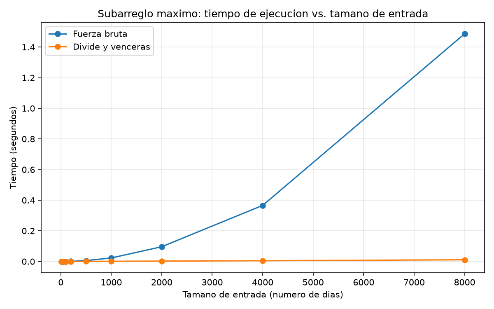

# Laboratorio evaluativo 02 — Dividir y vencer

**Nombre:** Sebastián Jesús Pérez Araujo
**Curso:** Análisis de Algoritmos

## Instrucciones para reproducir el experimento

Estos pasos se corren desde la raíz del repositorio (`curso-analisis-algoritmos/`). El entorno virtual (`venv/`) ya existe ahí; solo hay que activarlo.

### 1. Activar el entorno virtual

Elige el comando según tu sistema operativo y terminal:

**Linux / macOS (bash o zsh):**
```bash
source venv/bin/activate
```

**Linux / macOS (fish):**
```bash
source venv/bin/activate.fish
```

**Windows (PowerShell):**
```powershell
venv\Scripts\Activate.ps1
```

**Windows (cmd):**
```cmd
venv\Scripts\activate.bat
```

Si todo salió bien, la terminal muestra el prefijo `(venv)` antes del prompt.

### 2. Instalar las dependencias (solo la primera vez)

```bash
pip install -r requirements.txt
```

### 3. Entrar a la carpeta del laboratorio

```bash
cd lab2-divide-y-vencer
```

### 4. Ejecutar las pruebas y la medición

```bash
# Parte 1: verifica las dos soluciones (si algo falla, lanza un AssertionError)
python3 pruebas.py

# Parte 2: mide los tiempos y guarda graficas/tiempo_vs_n.png
python3 medicion.py
```

En Windows, si `python3` no es reconocido, usa `python` en su lugar.

La medición tarda unos segundos, casi todo en la fuerza bruta con n = 8000.

---

## Parte 1. Implementación y pruebas

**Código:** [subarreglo.py](subarreglo.py) | **Pruebas:** [pruebas.py](pruebas.py)

Se implementaron dos soluciones para encontrar el subarreglo máximo: fuerza bruta y divide y vencerás.

Las pruebas comprueban que ambas soluciones obtengan la misma suma, que los índices sean correctos y que la lista original no cambie. Se evaluaron listas de uno y dos elementos, valores positivos, negativos y cero, listas con todos los valores negativos, listas con todos los valores positivos, un subarreglo que cruza el punto medio y una serie de ocho días cuya suma es 17. También se probaron 160 listas aleatorias con una semilla fija.

Todas las pruebas pasaron correctamente.

## Parte 2. Medición de tiempos

**Código:** [medicion.py](medicion.py)

La gráfica `graficas/tiempo_vs_n.png` compara los tiempos de ejecución de ambos algoritmos.



Se generaron listas con valores entre -100 y 100 usando la semilla 42. Ambos algoritmos recibieron la misma lista para cada tamaño. Cada medición se repitió tres veces y se tomó la mediana. No se incluyó el tiempo de generación de los datos y se comprobó que ambas soluciones obtuvieran la misma suma.

| Tamaño (n) | Fuerza bruta (s) | Divide y vencerás (s) |
|---:|---:|---:|
| 10 | 0.000004 | 0.000008 |
| 20 | 0.000009 | 0.000017 |
| 50 | 0.000051 | 0.000041 |
| 100 | 0.000237 | 0.000126 |
| 200 | 0.000740 | 0.000185 |
| 500 | 0.005669 | 0.000538 |
| 1000 | 0.022835 | 0.001126 |
| 2000 | 0.096262 | 0.002458 |
| 4000 | 0.366158 | 0.004930 |
| 8000 | 1.486362 | 0.010947 |

## Parte 3. Análisis

### 3.1. Complejidad de los algoritmos

En divide y vencerás, la lista se divide en dos subproblemas de tamaño n/2. Después se resuelve cada mitad y se busca el mejor subarreglo que cruza el punto medio. Este último paso recorre los elementos de ambos lados, por lo que cuesta Θ(n).

La recurrencia es:

T(n) = 2T(n/2) + Θ(n)

Para aplicar el método maestro, tenemos a = 2, b = 2 y f(n) = Θ(n). Como n^(log₂ 2) = n, entonces f(n) = Θ(n) tiene el mismo orden de crecimiento que n^(log₂ 2). Por esta razón se cumple la condición del caso 2 del método maestro y la complejidad es **Θ(n log n)**.

En fuerza bruta se prueban todos los subarreglos posibles. La cantidad de segmentos es:

n + (n-1) + ... + 1 = n(n+1)/2

Como la suma se va acumulando, cada segmento nuevo requiere una suma y una comparación, es decir, tiempo constante. Por eso, el trabajo total es proporcional a n(n+1)/2. El término que más crece es n², así que la complejidad es **Θ(n²)**.

### 3.2. Comparación de los resultados con la teoría

En la gráfica, la curva de fuerza bruta se inclina hacia arriba cada vez más rápido, mientras que la de divide y vencerás permanece casi pegada al eje horizontal. Con 8000 elementos, sus tiempos son aproximadamente 1.49 segundos y 0.011 segundos, respectivamente.

Al pasar de 4000 a 8000 elementos, fuerza bruta aumenta de 0.366158 a 1.486362 segundos, unas 4.06 veces. Esto se acerca al factor 4 esperado para Θ(n²). Divide y vencerás pasa de 0.004930 a 0.010947 segundos, unas 2.22 veces. Para Θ(n log n), el factor teórico es:

(8000 log₂ 8000) / (4000 log₂ 4000) ≈ 2.17

La diferencia entre los valores medidos y los teóricos puede deberse a las condiciones de ejecución y a la variación de las mediciones. En general, los resultados concuerdan con las complejidades calculadas.

### 3.3. ¿Desde qué tamaño conviene divide y vencerás?

Con 10 y 20 elementos, fuerza bruta es más rápido. Con 50 elementos, divide y vencerás ya obtiene un mejor resultado. Por tanto, en estas pruebas el cambio ocurre entre 20 y 50 elementos.

Esto se debe a que las llamadas recursivas y el manejo de resultados añaden trabajo que pesa más en listas pequeñas. Cuando aumenta la entrada, el crecimiento cuadrático de fuerza bruta hace que su tiempo aumente mucho más rápido.

### 3.4. ¿Qué ocurre si solo queremos encontrar el valor máximo?

Si se divide la lista en dos mitades, se busca el máximo de cada una y luego se comparan ambos resultados. Combinar las soluciones solo requiere comparar dos números, por lo que cuesta Θ(1). La recurrencia es:

T(n) = 2T(n/2) + Θ(1)

Aquí a = 2, b = 2 y f(n) = Θ(1). Como n^(log₂ 2) = n y Θ(1) crece más lentamente que n, se cumple la condición del caso 1 del método maestro. La complejidad es **Θ(n)**.

Por tanto, dividir la lista no mejora la complejidad: recorrerla una sola vez para encontrar el máximo también cuesta Θ(n), pero requiere menos trabajo adicional.

En el problema del subarreglo máximo sí hay una mejora, porque divide y vencerás reduce la complejidad de Θ(n²) a Θ(n log n). Esto es posible porque encuentra el mejor subarreglo que cruza el punto medio en tiempo proporcional a n.

### 3.5. Recomendación para la gerente de la cooperativa

Recomendaría utilizar divide y vencerás para analizar grandes volúmenes de datos. Para series de 2000 días, ambos algoritmos pueden resultar útiles; sin embargo, al trabajar con sensores que generan cientos de miles de registros, fuerza bruta puede tardar demasiado.

Al pasar de 8000 a un millón de elementos, la entrada aumenta 125 veces. Para fuerza bruta, el factor estimado es 125² = 15625:

1.486 × 15625 ≈ 23219 segundos, unas 6.45 horas.

Para divide y vencerás, el factor aproximado es:

125 × (log₂ 1000000 / log₂ 8000) ≈ 192

Por tanto, el tiempo estimado sería:

0.010947 × 192 ≈ 2.1 segundos.

Estos tiempos son estimaciones basadas en las mediciones realizadas, no pruebas con un millón de elementos. Aunque el resultado real dependerá del equipo y de las condiciones de ejecución, la diferencia muestra que divide y vencerás es la alternativa más conveniente para procesar grandes cantidades de registros.
