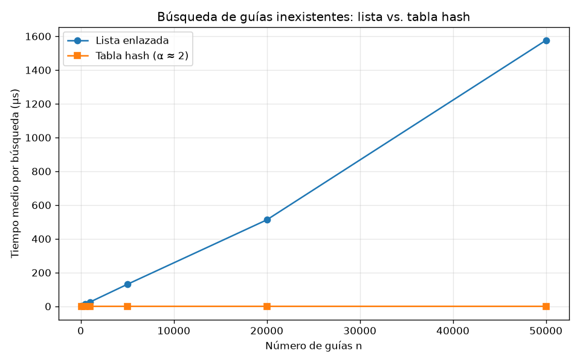
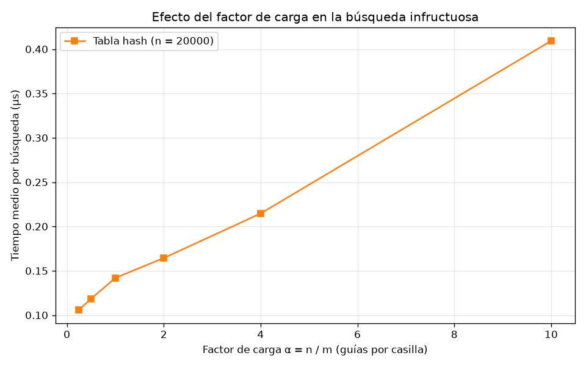

# Laboratorio evaluativo 03 — Estructuras de datos

**Nombre:** Sebastián Jesús Pérez Araujo
**Curso:** Análisis de Algoritmos

## Instrucciones para reproducir el experimento

Estos pasos se corren desde la raíz del repositorio (`curso-analisis-algoritmos/`). El entorno virtual (`venv/`) ya existe ahí; solo hay que activarlo.

### 1. Activar el entorno virtual

**Linux / macOS (bash o zsh):**
```bash
source venv/bin/activate
```

**Linux / macOS (fish):**
```bash
source venv/bin/activate.fish
```

**Windows (PowerShell):**
```powershell
venv\Scripts\Activate.ps1
```

**Windows (cmd):**
```cmd
venv\Scripts\activate.bat
```

Si todo salió bien, la terminal muestra el prefijo `(venv)` antes del prompt.

### 2. Instalar las dependencias (solo la primera vez)

```bash
pip install -r requirements.txt
```

### 3. Entrar a la carpeta del laboratorio

```bash
cd lab3-estructuras-datos
```

### 4. Ejecutar las pruebas y la medición

```bash
# Parte 1: verifica las dos estructuras (si algo falla, lanza un AssertionError)
python3 pruebas.py

# Parte 2: mide los tiempos, imprime las tablas y guarda las dos gráficas en graficas/
python3 medicion.py
```

En Windows, si `python3` no es reconocido, usa `python` en su lugar.

La medición tarda unos 4 segundos, casi todo en la lista enlazada con n = 50000.

---

## Parte 1. Implementación y verificación

**Código:** [estructuras.py](estructuras.py) | **Pruebas:** [pruebas.py](pruebas.py)

Se implementaron una lista enlazada con inserción al inicio y una tabla hash con encadenamiento. La tabla utiliza la función h(k) = k mod m y cada casilla contiene una `ListaEnlazada`. De esta manera, no se usan `dict`, `set` ni `hash()` de Python. La búsqueda en la lista se hace de forma iterativa, con un ciclo `while`, para evitar problemas con el límite de recursión.

Las pruebas incluyen los siguientes casos:

- La serie de ejemplo del enunciado, con cuatro guías. Se comprueba que las cuatro se encuentren y que una búsqueda de una guía inexistente devuelva `None`, tanto en la lista como en la tabla.
- Las estructuras vacías, donde todas las búsquedas devuelven `None` y el factor de carga es 0.
- Una colisión forzada con m = 7. Las guías 10, 24 y 17 llegan a la casilla 3 y se pueden encontrar después de insertarlas. Esa casilla tiene longitud 3 y las otras seis quedan vacías. También se busca la guía 31, que llega a la misma casilla, pero no existe. Esto obliga a recorrer toda la cadena antes de terminar.
- El factor de carga después de insertar las tres guías, que debe ser 3 / 7.
- Una tabla con m = 1, donde todas las guías terminan en la misma casilla y la estructura se comporta como una lista.
- Treinta colecciones aleatorias, generadas con semilla 2026, con entre 1 y 300 guías de diez dígitos y distintos valores de m: 1, 7, 13, 97 y 101. En cada colección se compara el resultado de la lista y la tabla para todas las guías existentes. También se comprueba que ambas devuelvan `None` para 30 guías inexistentes.

Todas las pruebas pasaron.

## Parte 2. Medición y gráficas

**Código:** [medicion.py](medicion.py)

Las guías se generaron con la semilla 42, utilizando enteros distintos de diez dígitos. Las guías inexistentes se generaron con la función indicada en el enunciado y la semilla 7. Para cada tamaño n, ambas estructuras recibieron las mismas guías.

Antes de medir los tiempos, se comprobó que la lista y la tabla devolvieran el mismo estado para una muestra de 200 guías existentes.

La medición incluye únicamente las 200 búsquedas de guías inexistentes, utilizando `time.perf_counter()`. No se cuenta el tiempo de construcción de las estructuras ni el de generación de los datos. Cada tanda se ejecutó siete veces y se tomó la mediana del tiempo medio por búsqueda. Al principio se hicieron tres repeticiones, pero los tiempos de la tabla variaban bastante entre ejecuciones porque estaban en el orden de décimas de microsegundo. Por eso se aumentó el número de repeticiones a siete.

### Experimento A — Lista frente a tabla

Para cada tamaño n, se eligió el número primo más cercano a n / 2 como valor de m. Así, el factor de carga α se mantiene alrededor de 2.



| n | m | α | Lista (µs) | Tabla (µs) |
|---:|---:|---:|---:|---:|
| 100 | 47 | 2.13 | 3.01 | 0.157 |
| 500 | 251 | 1.99 | 12.44 | 0.148 |
| 1000 | 499 | 2.00 | 25.67 | 0.162 |
| 5000 | 2503 | 2.00 | 130.41 | 0.160 |
| 20000 | 10007 | 2.00 | 512.44 | 0.164 |
| 50000 | 24989 | 2.00 | 1575.96 | 0.163 |

En la gráfica, los tiempos de la tabla parecen pegados al eje porque son unas 10.000 veces menores que los de la lista con n = 50000. Por eso también se incluye una tabla con los valores medidos.

### Experimento B — Efecto del factor de carga

Se mantuvo n = 20000 y se modificó m, eligiendo el primo más cercano a n / α para obtener distintos factores de carga.



| m | α | Tabla (µs) |
|---:|---:|---:|
| 79999 | 0.25 | 0.106 |
| 40009 | 0.50 | 0.118 |
| 19997 | 1.00 | 0.142 |
| 10007 | 2.00 | 0.164 |
| 4999 | 4.00 | 0.215 |
| 1999 | 10.01 | 0.409 |

## Parte 3. Análisis de resultados

### 1. Costo teórico

En una lista enlazada, buscar una guía inexistente requiere recorrer los n nodos, por lo que el costo es Θ(n).

En una tabla hash, el costo esperado es Θ(1 + α), donde α = n/m es el factor de carga, n es la cantidad de guías y m el número de casillas. Calcular la casilla cuesta Θ(1) y cada casilla tiene, en promedio, n/m = α guías. Una búsqueda infructuosa recorre la lista de esa casilla, por eso su costo esperado es Θ(1 + α). Bajo el supuesto de **hash uniforme simple**, las guías se distribuyen uniformemente. Si todas caen en la misma casilla, la búsqueda puede requerir revisar n elementos y el costo vuelve a Θ(n).

### 2. Lo medido contra lo esperado

En la primera gráfica, el tiempo de la lista enlazada aumenta con n. Al pasar de 1.000 a 5.000 elementos, crece por un factor de 5,08, consistente con Θ(n).

Para la tabla hash, con esos mismos valores de n, el tiempo cambia de 0,162 a 0,160 µs, un factor de 0,99. Esto concuerda con Θ(1) cuando α se mantiene controlado. Con α cercano a 0, el tiempo no baja de unos 0,1 µs, que corresponde al costo fijo de calcular la casilla.

La segunda gráfica muestra que, al aumentar α de 0,25 a 10, el tiempo pasa de 0,106 a 0,409 µs. El aumento es aproximadamente de 0,031 µs por unidad de α, lo que concuerda con el crecimiento esperado Θ(1 + α).

### 3. Explique las colisiones

Una colisión ocurre cuando varias claves corresponden a la misma casilla. La función hash calcula el residuo, pero no comprueba si la casilla está libre. Como hay muchas más guías posibles que casillas, distintas claves pueden compartir el mismo residuo, incluso si hay más casillas que guías almacenadas.

Con m = 7 y h(k) = k mod 7, se obtiene h(10) = h(24) = h(17) = 3.

Con **encadenamiento**, las claves se guardan en una lista enlazada en la casilla 3: `17 → 24 → 10`. Su ventaja es que permite almacenar varias claves en una casilla; su costo es que la búsqueda se alarga cuando hay muchas colisiones.

Con **direccionamiento abierto mediante sondeo lineal**, las claves ocupan la siguiente casilla libre: 10 queda en la casilla 3, 24 en la 4 y 17 en la 5. Su ventaja es que los elementos permanecen dentro de la tabla. Sin embargo, las casillas ocupadas pueden formar grupos que ralentizan la búsqueda. Además, α no puede superar 1 porque cada casilla almacena como máximo una clave, y borrar elementos es más difícil porque puede afectar las búsquedas posteriores.

### 4. Tabla hash o árbol de búsqueda

La tabla hash permite buscar una guía concreta rápidamente, pero no es adecuada para consultar rangos porque las claves no están ordenadas. Encontrar todas las guías entre dos valores puede exigir revisar toda la tabla.

Un árbol binario de búsqueda permite recorrer las claves en orden. Una consulta de rango puede costar Θ(h + k), donde h es la altura y k la cantidad de resultados encontrados.

Al insertar 400.000 guías ordenadas de menor a mayor en un árbol sin balancear, cada nueva guía queda a la derecha de la anterior. La altura es 399.999 y una búsqueda puede requerir unas 400.000 comparaciones. En un árbol balanceado, la altura sería aproximadamente log₂(400.000) ≈ 18,6, es decir, unas 19 comparaciones. El árbol degenerado puede necesitar unas 21.000 veces más comparaciones.

### 5. Concepto para la jefa de operaciones

Recomendaría combinar una tabla hash con un árbol de búsqueda balanceado: la primera permite consultar una guía específica y el segundo facilita el monitoreo por rangos.

Estos valores son estimaciones, no mediciones. Como la primera gráfica es una recta, el tiempo de la lista enlazada crece en proporción a n. Usando como referencia 0,032 µs por nodo, revisar 5 millones de envíos tomaría aproximadamente 0,16 segundos; para 400.000 nodos, unos 13 ms.

Como la curva de la tabla hash es plana con α ≈ 2, se puede estimar un tiempo cercano a 0,16 µs por búsqueda con aproximadamente 2,5 millones de casillas. Esto supone una función hash eficiente y una distribución adecuada de las claves. La tabla hash resuelve las búsquedas individuales, mientras que el árbol balanceado permite consultar rangos sin recorrer todos los registros.
